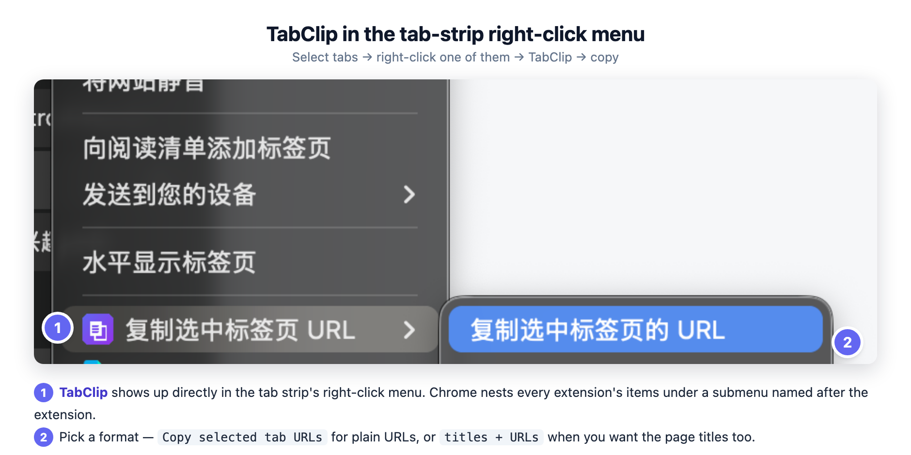
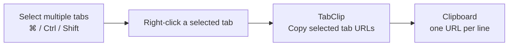
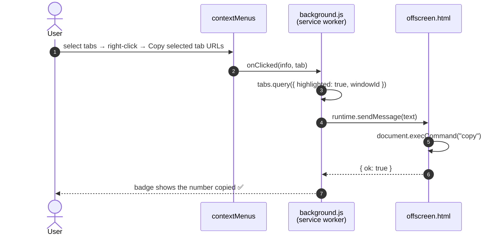

<div align="center">


# TabClip

**Copy every tab you picked — in one right-click.**

<a href="README.zh-CN.md">简体中文</a> · **English**

<a href="LICENSE"></a>


</div>

---

## 😤 Why TabClip exists

Chrome lets you select multiple tabs with `⌘` / `Ctrl` / `Shift`, but it gives you **no way to copy the URLs of the tabs you selected**:

- Right-clicking a tab only offers "Copy" for **that one** link
- Batch-copying means clicking and copying one tab at a time
- Most existing extensions are heavyweight — popups, new-tab takeovers, broad permissions — and **many put their menu in the page right-click menu**, not where you'd naturally reach for it: the tab strip
- Worse, **before Chrome 150, extensions couldn't add anything to the tab-strip context menu at all**

TabClip fills exactly that one gap — **no popup, no redirect, no telemetry**. It adds a couple of rows to the tab-strip right-click menu and copies the addresses of the tabs you picked.

> [!NOTE]
> The tab-strip menu relies on Chrome 150+'s `chrome.contextMenus` `"tab"` context. On older versions, TabClip still works via the page right-click menu, the toolbar icon, and a keyboard shortcut.

<p align="center">
  
  <br>
  <sub>Right-click the tab strip → <b>TabClip</b> → Copy selected tab URLs</sub>
</p>

> [!TIP]
> Chrome nests extension items under a submenu **named after the extension**, hence the `TabClip ›` you see above. That keeps every extension from cluttering the native menu.

## ✨ Features

| | Feature | Details |
|---|---|---|
| 🎯 | **Only the selected tabs** | Select with `⌘`/`Ctrl`, then right-click one of the **selected** tabs |
| 🔤 | **Two formats** | Plain URLs (one per line) or `Title + URL` |
| 🔢 | **In tab-strip order** | Sorted left-to-right, not by click order |
| 🖱️ | **Three entry points** | Tab-strip menu · page menu · toolbar icon |
| ⌨️ | **Keyboard shortcut** | `Alt+Shift+C` |
| ✅ | **Instant feedback** | The toolbar badge briefly shows how many tabs were copied; a red `!` on failure |
| 🔒 | **Privacy-friendly** | Zero network requests, zero data collection, only 4 permissions |
| 🪶 | **Zero dependencies** | Plain JavaScript, no build step, no bundling |

## 🚀 Install

<details open>
<summary><b>Option 1 — Download the release (recommended for users)</b></summary>

1. Open [**Releases**](https://github.com/ursasi/tabclip/releases/latest) and download `TabClip-x.y.z.zip`
2. Unzip it anywhere
3. Open `chrome://extensions` → turn on **Developer mode** (top-right)
4. Click **Load unpacked** → pick the unzipped folder

</details>

<details>
<summary><b>Option 2 — From source (recommended for developers)</b></summary>

```bash
git clone https://github.com/ursasi/tabclip.git
```

Then `chrome://extensions` → Developer mode → **Load unpacked** → select the `tabclip/` folder.

</details>

> [!IMPORTANT]
> Chrome 150+ is required for the tab-strip menu. After editing the code, click the **↻** on the extension card in `chrome://extensions` to reload.

## 🧑‍💻 Usage

```text
1. Select several tabs with ⌘ / Ctrl / Shift
2. Right-click one of the SELECTED tabs
3. Choose "Copy selected tab URLs"
```

The clipboard then looks like:

```text
https://github.com/ursasi/tabclip
https://developer.chrome.com/docs/extensions/reference/api/contextMenus
https://developer.chrome.com/docs/extensions/reference/api/tabs
```



> [!WARNING]
> **The right-click must land on a selected tab.** That's Chrome's own behavior: right-clicking an *unselected* tab collapses the multi-selection down to just that tab. To copy several, right-click one of the already-highlighted ones.

## 🧠 How it works

1. `chrome.contextMenus.create({ contexts: ["tab"] })` — registers the items in the tab-strip menu ([Chrome 150+](https://developer.chrome.com/docs/extensions/whats-new))
2. The click handler gets the `windowId` of the window where the right-click happened
3. `chrome.tabs.query({ highlighted: true, windowId })` — reads **every highlighted/selected tab** in that window, sorted by `index`
4. The text is handed to an **offscreen document** to write to the clipboard (an MV3 service worker has no DOM and can't call the clipboard API directly)



## 🔐 Permissions

TabClip requests only 4 permissions — the minimum needed for exactly this job:

| Permission | Why |
|---|---|
| `tabs` | Read each tab's `url` / `title` / `index`, and which tabs are selected |
| `contextMenus` | Register entries in the tab-strip / page right-click menus |
| `clipboardWrite` | Write the result to the clipboard |
| `offscreen` | Create a hidden document to perform the clipboard write (no DOM in an MV3 service worker) |

**No** host permissions, **no** network requests, and **no** content scripts injected into any page.

## 🌐 Localization

TabClip ships with **English and Simplified Chinese** UI strings and **follows your browser's UI language automatically** — there's no setting to flip.

```text
_locales/
├── en/messages.json        # fallback (default_locale)
└── zh_CN/messages.json
```

How Chrome decides which language to show:

1. `manifest.json` declares `"default_locale": "en"`.
2. Chrome reads your **browser UI language** (the list in `chrome://settings/languages`) and looks for the closest matching folder under `_locales/`.
3. `chrome.i18n.getMessage("menuCopyUrls")` returns that locale's string, and `__MSG_extName__` in the manifest is resolved the same way.
4. If nothing matches, it falls back to `default_locale` — English.

> [!NOTE]
> The choice is based on the **browser UI language**, not the language of the page you're on. So with a Chinese Chrome you get Chinese menus even on English websites, and vice-versa.

**Add another language:** copy `_locales/en/messages.json` to `_locales/<locale>/messages.json` (e.g. `ja`, `de`, `fr`), translate the `message` values — **keep the keys** — and reload the extension.

**Check your current language:** open `chrome://settings/languages`, or run `chrome.i18n.getUILanguage()` in the extension's Service Worker console.

## 📁 Project structure

```text
tabclip/
├── manifest.json                 # MV3 manifest (permissions, command, icons)
├── background.js                 # register menus · read selected tabs · write clipboard
├── offscreen.html / offscreen.js # hidden document that performs the clipboard write
├── _locales/                     # en + zh_CN UI strings
├── icons/                        # 16 / 32 / 48 / 128 / 256 PNG
├── tools/
│   ├── gen_icons.py              # reproducible icon generator (stdlib only)
│   └── annotate_screenshot.py    # builds docs/screenshot.png from screenshot-raw.png
└── docs/                         # banner + screenshots
```

## 🛠️ Development

After changing the code, click **↻** on the extension card in `chrome://extensions` to reload.

Debugging: open the extension's **Service Worker** console from `chrome://extensions` — every log from `background.js` (e.g. `写剪贴板失败:`) shows up there.

Regenerate the icons:

```bash
python3 tools/gen_icons.py
```

## ❓ FAQ

<details>
<summary><b>I don't see TabClip in the menu.</b></summary>

Your Chrome is older than 150. Update Chrome, or use the **page right-click menu / toolbar icon / `Alt+Shift+C`** instead.

</details>

<details>
<summary><b>Only one URL got copied.</b></summary>

You right-clicked an **unselected** tab, so Chrome collapsed the selection down to that single tab. Right-click one of the **highlighted** tabs instead.

</details>

<details>
<summary><b>Nothing happens when I click it.</b></summary>

Open the Service Worker console and check for errors. Most of the time the clipboard is momentarily locked by the OS or another app — just try again.

</details>

<details>
<summary><b>How is this different from Tab Copy and friends?</b></summary>

Extensions like Tab Copy focus on exporting the **whole window / all tabs** with many formats (JSON, CSV, …) — powerful but heavier. TabClip does one thing only: **copy the few tabs you selected**, in a single action, with zero friction. They can coexist happily.

</details>

## 🗺️ Roadmap

- [x] Tab-strip right-click menu (Chrome 150+)
- [x] URL / Title + URL formats
- [x] Toolbar icon + keyboard shortcut
- [ ] Options page: default format, separator, de-duplication, skip pinned tabs
- [ ] Markdown / JSON output
- [x] Internationalization (`_locales`, English + Simplified Chinese)

## 🤝 Contributing

PRs and issues are welcome. Before submitting, please keep it: **zero dependencies, minimal surface area, and no network requests.**

## 📄 License

[MIT](LICENSE) © 2026 Shuohua Zhang ([@ursasi](https://github.com/ursasi))

---

<div align="center">

**If this little tool saved you a few clicks, a ⭐ is the best motivation.**

<sub>Made with ❤️ and a deep hatred of copying tabs one by one.</sub>

</div>
