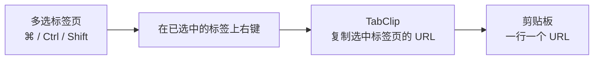
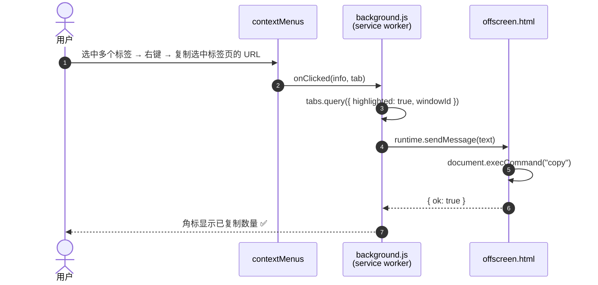

<div align="center">


# TabClip

**Copy every tab you picked — in one right-click.**
多选标签页 → 右键 → 一键复制这些标签页的 URL。

<a href="LICENSE"></a>


</div>

---

## 😤 为什么会有这个小工具

Chrome 允许你用 `⌘` / `Ctrl` / `Shift` **一次选中多个标签页**，但它**没有提供任何办法把选中的这些标签页的 URL 复制出来**：

- 在标签上右键 → 只有「复制」**当前这一个**链接
- 想批量拿地址，只能一个标签一个标签手点手抄
- 现成的扩展大多很重：弹窗、接管新标签页、要一堆权限，而且**很多把菜单塞在「网页右键」里**，而不是你想点的「标签栏右键」
- 更要命的是，**在 Chrome 150 之前，第三方扩展根本没法往标签栏右键菜单里加东西**

TabClip 就只补这一个空缺 —— **不弹窗、不跳转、不收集数据**，只在标签栏的右键菜单里加上两行，点一下就把你选中的标签页地址复制走。

> [!NOTE]
> 标签栏右键菜单依赖 Chrome 150+ 的 `chrome.contextMenus` `"tab"` 上下文。低于该版本时，TabClip 仍可通过「网页右键 / 工具栏图标 / 快捷键」使用。

```text
在标签栏右键（和 SingleFile 出现在同一区域）：
┌───────────────────────────────┐
│  重新加载                      │
│  复制                          │
│  固定                          │
│  …                            │
│  ────────────────────────────  │
│  复制选中标签页的 URL           │  ← TabClip
│  复制选中标签页的标题 + URL      │  ← TabClip
│  ────────────────────────────  │
│  关闭其他标签页                 │
└───────────────────────────────┘
```

## ✨ 功能

| | 功能 | 说明 |
|---|---|---|
| 🎯 | **只复制选中的标签** | `⌘`/`Ctrl` 间隔选、`Shift` 连续选，然后在**已选中的标签**上右键 |
| 🔤 | **两种格式** | 纯 URL（一行一个）/ `标题 + URL` |
| 🔢 | **按标签栏顺序** | 按标签从左到右输出，不是按点击顺序 |
| 🖱️ | **三个入口** | 标签栏右键 · 网页右键 · 工具栏图标 |
| ⌨️ | **快捷键** | `Alt+Shift+C` |
| ✅ | **即时反馈** | 成功后工具栏角标短暂显示复制了几个；失败显示红色 `!` |
| 🔒 | **隐私友好** | 零网络请求，零数据收集，只用必要的 4 个权限 |
| 🪶 | **零依赖** | 纯原生 JS，无需构建、无需打包 |

## 🚀 安装

<details open>
<summary><b>方式一：从 Release 下载（推荐给普通用户）</b></summary>

1. 打开 [**Releases**](https://github.com/ursasi/tabclip/releases/latest)，下载 `TabClip-x.y.z.zip`
2. 解压到任意文件夹
3. 打开 `chrome://extensions` → 右上角打开 **开发者模式**
4. 点 **加载已解压的扩展程序** → 选解压出来的文件夹

</details>

<details>
<summary><b>方式二：从源码（推荐给开发者）</b></summary>

```bash
git clone https://github.com/ursasi/tabclip.git
```

然后 `chrome://extensions` → 开发者模式 → **加载已解压的扩展程序** → 选 `tabclip/` 目录。

</details>

> [!IMPORTANT]
> 扩展需要 **Chrome 150+** 才有标签栏右键菜单。`chrome://extensions` 里改代码后点扩展卡片上的 **↻** 重新加载即可生效。

## 🧑‍💻 使用

```text
1. 用 ⌘ / Ctrl / Shift 选中多个标签页
2. 在【已选中的标签】上点右键
3. 选「复制选中标签页的 URL」
```

复制出来长这样：

```text
https://github.com/ursasi/tabclip
https://developer.chrome.com/docs/extensions/reference/api/contextMenus
https://developer.chrome.com/docs/extensions/reference/api/tabs
```



> [!WARNING]
> **右键必须落在「已选中」的标签上。** 这是 Chrome 自身的行为：右键一个未选中的标签，会把当前的多选收缩成它自己。想复制多个，就点已经高亮的那几个中的一个。

## 🧠 原理 / How it works

1. `chrome.contextMenus.create({ contexts: ["tab"] })` —— 把菜单项注册进标签栏右键菜单（[Chrome 150+](https://developer.chrome.com/docs/extensions/whats-new)）
2. 点击回调拿到右键所在窗口的 `windowId`
3. `chrome.tabs.query({ highlighted: true, windowId })` —— 取出该窗口**所有高亮/选中**的标签，按 `index` 排序
4. 文本交给 **offscreen 文档**写入剪贴板（MV3 的 service worker 没有 DOM，无法直接调用剪贴板 API）



## 🔐 权限说明

TabClip 只申请 4 个权限，全部是完成这件事的最小集合：

| 权限 | 用途 |
|---|---|
| `tabs` | 读取标签页的 `url` / `title` / `index`，以及哪些标签处于「选中」状态 |
| `contextMenus` | 往标签栏 / 网页右键菜单注册条目 |
| `clipboardWrite` | 把结果写入剪贴板 |
| `offscreen` | 创建隐藏文档来执行剪贴板写入（MV3 service worker 无 DOM） |

**没有** 任何 host 权限，**没有** 任何网络请求，**不在** 任何页面注入内容脚本。

## 📁 文件结构

```text
tabclip/
├── manifest.json        # MV3 清单（权限、命令、图标）
├── background.js        # 注册菜单 · 取选中标签 · 写剪贴板
├── offscreen.html       # 剪贴板用的隐藏文档
├── offscreen.js         # 实际的复制逻辑
├── icons/               # 16 / 32 / 48 / 128 / 256 PNG
├── tools/gen_icons.py   # 图标生成脚本（纯标准库，可复现）
└── docs/banner.svg      # README 头图
```

## 🛠️ 开发

改完代码后在 `chrome://extensions` 点扩展卡片上的 **↻ 重新加载**。

调试：在 `chrome://extensions` 打开本扩展的 **Service Worker** 控制台 —— `background.js` 的日志（例如 `写剪贴板失败:`）都在那里。

重新生成图标：

```bash
python3 tools/gen_icons.py
```

## ❓ FAQ

<details>
<summary><b>菜单里看不到 TabClip？</b></summary>

Chrome 版本低于 150。升级 Chrome，或改用 **网页右键 / 工具栏图标 / `Alt+Shift+C`**。

</details>

<details>
<summary><b>为什么只复制出来一个 URL？</b></summary>

右键时点在**未选中**的标签上了，Chrome 会把多选收缩成它自己。请右键**已高亮**的标签。

</details>

<details>
<summary><b>点了没反应？</b></summary>

打开 Service Worker 控制台看报错。多为剪贴板被系统或其他软件临时占用，重试即可。

</details>

<details>
<summary><b>和 Tab Copy 这类扩展有什么区别？</b></summary>

Tab Copy 等主打「导出**整个窗口 / 全部**标签」，格式多（JSON、CSV…），功能全但较重。TabClip 只做一件事：**复制你选中的那几个**，一个动作，零干扰。两者可以共存。

</details>

## 🗺️ Roadmap

- [x] 标签栏右键菜单（Chrome 150+）
- [x] URL / 标题 + URL 两种格式
- [x] 工具栏图标 + 快捷键
- [ ] 设置页：默认格式、分隔符、去重、排除固定标签
- [ ] Markdown / JSON 输出
- [ ] 多语言（`_locales`）
- [ ] 发布到 Edge Add-ons（免费）

## 🤝 贡献

欢迎 PR / Issue。提交前请确保：**零依赖、只在必要处动代码、不引入任何网络请求**。

## 📄 许可

[MIT](LICENSE) © 2026 Shuohua Zhang ([@ursasi](https://github.com/ursasi))

---

<div align="center">

**如果这个小工具帮你省了几次手点，点个 ⭐ 就是最大的动力。**

<sub>Made with ❤️ and a deep hatred of copying tabs one by one.</sub>

</div>
